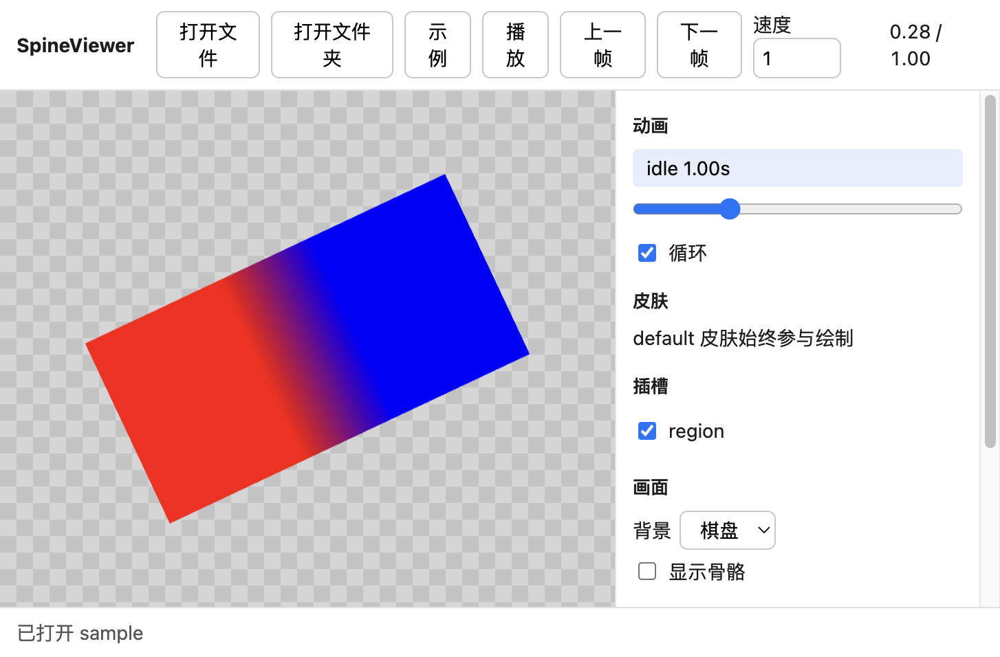

# SpineViewer

在浏览器里打开 Spine 骨骼，播放动画，并导出当前画面或 GIF。用浏览器打开 `index.html` 即可使用，文件只在本地读取，不会上传。

## 打开骨骼

把同一套文件拖进页面，或用「打开文件」「打开文件夹」。也可以先点「示例」看内置动画。

程序会按**同名、同目录**自动配成一套，例如：

- `hero.json`，或 `hero.skel`
- `hero.atlas`，也可以是 `hero.atlas.txt`
- atlas 里列出的贴图，例如 `hero.png`

名字对不上的文件不会混在一起。同一目录里 JSON 和 skel 都有时，优先使用 JSON。一个文件夹里有多套骨骼时，右侧「骨骼」列表可以切换。

## 支持的版本

| 导出的 Spine 版本 | 使用的播放器 |
| --- | --- |
| 3.3–3.7 | 3.7 |
| 3.8 | 3.8 |
| 4.0、4.1、4.2、4.3 | 对应版本 |

4.4 及以上会用 4.3 播放器尝试打开。3.2 及更早的文件打不开。

3.7 及更早的二进制 `.skel` 请先导出 JSON。3.8 及以后的 `.skel` 会按文件头里的版本选择播放器。

## 播放

- 空格播放或暂停，左右方向键逐帧。
- 拖动时间轴可以定位。速度和循环可以改。
- default 以外的皮肤可以叠加。
- 插槽前的勾选用来显示或隐藏部件。
- 背景可以换成棋盘、白、黑或灰，也可以显示骨骼。

## 导出

- 「导出 PNG」保存当前画面。棋盘背景下，PNG 是透明的。
- 「导出 GIF」按右侧帧率采样整段动画。最长边约 480 像素，最多约 150 帧。GIF 会带上当前背景色。

## 许可

Spine 播放器来自 Esoteric Software 的 Spine Runtimes，许可见 `vendor/SPINE-RUNTIMES-LICENSE.txt`。GIF 编码使用 gifenc，许可见 `vendor/GIFENC-LICENSE.txt`。
